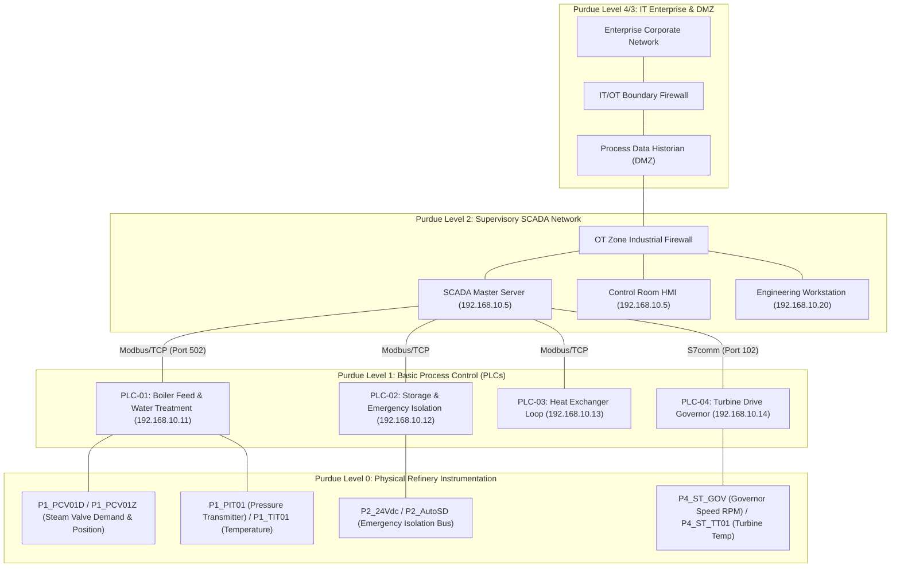

# AI-Assisted Cybersecurity Framework for a Simulated Oil & Gas Refinery

**Course**: 5th-Semester Cybersecurity Project  
**Institution**: Manipal University Jaipur  
**Repository**: `oil-gas-ics-cybersecurity`  
**Working Branch**: `Hemank-ai`  

---

## 1. Executive Project Overview

Industrial Control Systems (ICS) and Supervisory Control and Data Acquisition (SCADA) networks govern critical national infrastructure, including petroleum refineries, chemical plants, and pipeline distribution systems. Due to the historical convergence of Information Technology (IT) and Operational Technology (OT), critical assets are increasingly exposed to sophisticated cyber threats.

This project delivers an **academically defensible, fully functional AI-assisted cybersecurity prototype** for a simulated Oil & Gas refinery. It integrates:
1. **Vulnerability Assessment and Penetration Testing (VAPT)**: Authorised service enumeration, vulnerability prioritization, and mitigation verification.
2. **Controlled Attack Simulation**: Safe emulation of industrial cyber-physical exploits (Modbus setpoint tampering, valve spoofing, and Stuxnet-style physical perturbation).
3. **Dual-Paradigm AI Detection**: Unsupervised behavioral anomaly detection (Isolation Forest) paired with explainable signature classification (Random Forest) and cross-domain cyber-physical correlation.

---

## 2. Team Structure & Student Responsibilities

| Student | Assigned Role | Key Deliverables & Responsibilities |
| :--- | :--- | :--- |
| **Student 1** | **VAPT & Infrastructure Specialist** | Simulated OT network topology design, authorised reconnaissance, service discovery, vulnerability identification (`vapt_findings.json`), and mitigation re-testing verification. |
| **Student 2** *(Project Author)* | **AI/ML Detection Specialist & Group Leader** | Data pipeline engineering, leakage-free scaling, dual-paradigm model training, comparative benchmarking, real-time prediction interface, security alert system, interactive SCADA dashboard, and repository integration coordination. |
| **Student 3** | **Attack Simulation & Integration Specialist** | Stuxnet incident case study research, safe controlled attack simulation scripts (`attack_simulation.py`), Modbus command injection, and end-to-end demonstration assistance. |

---

## 3. Simulated Refinery SCADA Architecture

The framework simulates an industrial refinery based on the **Purdue Enterprise Reference Architecture (ISA-95 / IEC 62443)**:



### Monitored Refinery Subsystems:
- **Process Unit 1 (P1)**: Water Treatment & High-Pressure Steam Boiler Feed Loop.
- **Process Unit 2 (P2)**: Storage Tanks, Pumping Stations, and Emergency Isolation Interlocks.
- **Process Unit 3 (P3)**: Fractional Distillation Heat Exchanger & Auxiliary Cooling Circuit.
- **Process Unit 4 (P4)**: Rotating Machinery, Compressor Drive, and Turbine Governor.

---

## 4. Dataset Source & Scientific Methodology

- **Dataset**: **Hardware-in-the-Loop (HIL) Augmented ICS (HAI 23.05)**, published by the Korea Internet & Security Agency (KISA) and Affiliated Research Institutes ([https://github.com/icsdataset/hai](https://github.com/icsdataset/hai)).
- **Academic Relevance & Limitations**:
  - HAI 23.05 is an authoritative, public ICS security research testbed. It does not replicate an entire commercial petroleum refinery; rather, relevance to refinery cybersecurity is established through the physical control loops (pressure regulation, level control, thermal heat exchange, and turbine speed) and realistic cyber-physical attack scenarios.
- **Scale**:
  - **Training Baseline**: 572,400 observations (~159 continuous hours of benign normal operations).
  - **Test Benchmark**: 284,400 observations (~79 continuous hours containing 52 real attack scenarios).
  - **Features**: 86 continuous physical process measurements (1.0 Hz scan frequency).
  - **Class Imbalance**: Only **4.00%** of test observations are anomalous (24:1 normal-to-attack ratio).

---

## 5. Environment Setup & Installation Guide (Windows & VS Code)

### Prerequisites:
- Windows 10/11 with Python 3.10+ (tested on Python 3.14)
- Git & VS Code

### Installation Steps:
```powershell
# 1. Open VS Code in workspace root
cd "d:\sem5 project\oil-gas-ics-cybersecurity"

# 2. Verify git branch
git status

# 3. Install required dependencies
python -m pip install -r requirements.txt
```

### Verified Dependency Manifest:
- `pandas>=2.2.0` (time-series manipulation)
- `numpy>=1.26.0` (vectorized matrix computations)
- `scikit-learn>=1.5.0` (Isolation Forest, Random Forest, Logistic Regression, Scalers)
- `joblib>=1.4.0` (model serialization)
- `matplotlib>=3.8.0` & `seaborn>=0.13.0` (evaluation plots)
- `streamlit>=1.35.0` (interactive SCADA dashboard)

---

## 6. Project Execution Guide (Phases 1 through 9)

Every component is modular, reproducible, and executable from the terminal:

### Phase 2 — Dataset Inspection & Telemetry Audit
```powershell
python "ai detection/inspect_dataset.py"
```
*Outputs file inventory, schemas, missing values (0 nulls), timestamp alignment, and constant feature detection to `results/dataset_inspection_report.json`.*

### Phase 3 — Data Preparation & Leakage-Free Scaling
```powershell
python "ai detection/preprocessing/prepare_data.py"
```
*Fits `StandardScaler` exclusively on normal baselines with divide-by-zero protection, aligns labels 1:1, and saves compressed `.npz` arrays to `ai detection/dataset/processed/`.*

### Phase 4 — Multi-Model Training & Benchmarking
```powershell
python "ai detection/models/train_models.py"
```
*Trains Isolation Forest (Unsupervised), Logistic Regression, and Random Forest. Serializes trained models to `ai detection/models/*.joblib` and saves `results/model_benchmark_results.json`.*

### Phase 5 — Model Evaluation & Visualization Plot Generation
```powershell
python "ai detection/evaluation/evaluate_models.py"
```
*Generates publication-quality figures in `results/`: `confusion_matrices.png`, `roc_pr_curves.png`, `anomaly_score_timeline.png`, and `feature_importance.png`.*

### Phase 6 — Real-Time Prediction Interface Demo
```powershell
# Run 3-scenario demonstration (Normal, Attack 07, Stuxnet-Style)
python "ai detection/inference/predict.py"

# Or query a specific historical sample index
python "ai detection/inference/predict.py" --sample 24500
```

### Phase 7 — Security Alert System Simulation
```powershell
python "ai detection/inference/alert_system.py"
```
*Simulates SCADA stream, groups 624 raw alert seconds into cohesive incidents (`INC-001`), and writes `results/security_alerts.jsonl` and `results/security_alerts.csv`.*

### Phase 8 — Launch Interactive Streamlit SCADA Control Center
```powershell
python -m streamlit run dashboard/app.py
```
*Launches the browser dashboard at `http://localhost:8501` featuring the authentic industrial SCADA/HMI workstation with 14 operational sections.*

### Phase 9 — Run Integration & Verification Test Suite
```powershell
python -m unittest tests/test_refinery_operations.py
```
*Executes automated verification testing across asset registry integrity, deterministic telemetry simulation, AI inference on normal vs attack vectors, scenario execution, and facility status aggregation.*

---

## 7. Operational SCADA Architecture & Navigation Sections

The application provides **14 modular sections** designed strictly under ISA-101 / ISA-18.2 SCADA HMI guidelines:

1. **Plant Overview**: Supervisory facility KPIs, unit health, active process alarms, and detection readiness.
2. **Refinery Map**: Interactive 2D vector schematic (SVG) showing Purdue levels, piping runs, cyber conduits, and asset inspector.
3. **Live Operations**: Multi-pen strip charts with operating bands and nominal trip limits.
4. **Network Topology**: Purdue Model architecture with active industrial conduits and protocol inspector.
5. **Attack Simulation**: Safe execution of 6 deterministic scenarios (A through F) with traceable run IDs.
6. **AI Detection**: Continuous score-vs-threshold monitoring, calibrated +0.0132 threshold, and sensor attribution.
7. **Attack Playback**: 10-stage chronological timeline replay with Step Forward, Step Back, and Reset controls.
8. **Incident Investigation**: Incident dossier with state machine triage (`New` → `Investigating` → `Mitigated` → `Closed`).
9. **Mitigation & Recovery**: Countermeasure enforcement (OT Firewall DPI, Bastion, GPO) with before-and-after retest engine.
10. **ML Model Laboratory**: Research workstation with algorithm inventory, comparative benchmark table, individual model deep-dives, confusion matrices, and interactive threshold explorer.
11. **Manual Telemetry Tester**: Custom telemetry injection with physics limit validation and live inference.
12. **Normal vs Attack Comparison**: Synchronized side-by-side telemetry pairing with deviation metrics and variance bars.
13. **Demonstration Mode**: Scripted 12-stage examination presentation with progress tracking and executive audit.
14. **Event History & Audit Log**: Searchable, filterable audit log of simulation runs, detector outputs, and mitigation actions.

> **Scope Boundary Note on VAPT**:  
> In compliance with this development phase, Vulnerability Assessment & Penetration Testing (VAPT) workflows, scanner interfaces, and finding registers are intentionally excluded from the operational user interface. All underlying VAPT scan logs and analysis files are safely preserved in `vapt/` for future research modules.

---

## 8. Comparative Model Performance Benchmark

Evaluated on the full held-out test benchmark (**284,400 observations**, 52 distinct attack incidents):

| Model Name | Paradigm | Accuracy | Precision | Recall | F1-Score | ROC-AUC | False Positive Rate (FPR) | False Negative Rate (FNR) | Latency (ms / 1k) |
| :--- | :--- | :--- | :--- | :--- | :--- | :--- | :--- | :--- | :--- |
| **Isolation Forest** | **Unsupervised Behavioral** | **0.9294** | 0.1574 | 0.1756 | 0.1660 | **0.6257** | **0.0392** (3.92%) | 0.8244 | **13.85 ms** |
| **Random Forest** | **Supervised Ensemble** | **0.9619** | **0.5487** | 0.2707 | **0.3626** | **0.7885** | **0.0093** (0.93%) | 0.7293 | 42.42 ms |
| **Logistic Regression** | **Supervised Linear** | 0.5965 | 0.0586 | **0.6031** | 0.1069 | 0.6129 | 0.4038 (40.38%) | **0.3969** | **0.48 ms** |

### Why Accuracy is Deceptive in Industrial Security:
A naive model that predicts "Normal" for 100% of observations achieves a **96.00% Accuracy** while having a **0% Recall** (missing 100% of cyber attacks). Therefore, our evaluation focuses on **Precision, Recall, F1-Score, and False Positive/Negative Rates**.

---

## 9. Ethical Boundaries & Industrial Safety Protocols

1. **Isolation Mandate**: All vulnerability scanning, exploit simulation, and AI testing were conducted exclusively in isolated virtual/simulated environments on open benchmark data. Real refinery infrastructure was never targeted.
2. **Separation of Alerting from Physical Actuation**: In accordance with ANSI/ISA-62443, the AI detector **never directly issues control commands or automatically trips emergency valves**. Unverified automated shutdowns cause massive financial loss ($20,000–$100,000/hr) and can induce downstream physical surges. Human-in-the-loop validation is strictly enforced.
3. **Data Protection**: Large raw datasets (`*.csv`, `*.npz`) and model binaries (`*.joblib`) are excluded by `.gitignore` and remain strictly local.

