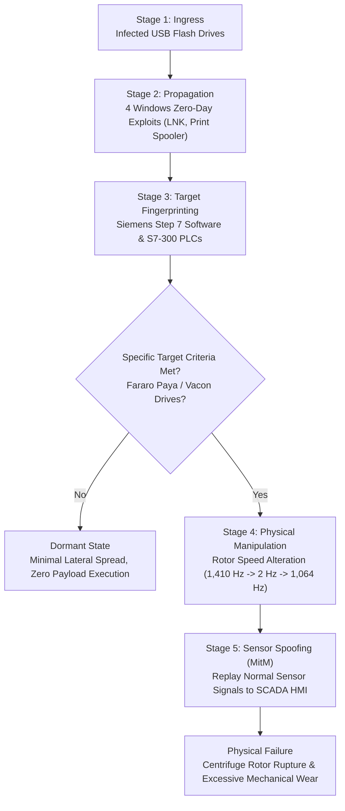

# Comprehensive Case Study: The Stuxnet Incident & ICS Defensive Lessons

**Academic Context**: 5th-Semester ICS Cybersecurity Project, Manipal University Jaipur  
**Project**: AI-Assisted Cybersecurity Framework for a Simulated Oil & Gas Refinery  
**Author**: Student 2 (AI/ML Detection Specialist & Group Leader) with Student 3 (Attack Simulation)

---

## 1. Executive Summary & Historical Context

Discovered in June 2010 by VirusBlokAda, **Stuxnet** was the world's first documented cyber warfare weapon engineered to inflict physical destruction upon industrial control equipment. Unlike traditional IT malware aimed at data exfiltration or extortion, Stuxnet was designed with extreme surgical specificity to sabotage gas centrifuges utilized for uranium enrichment at the Natanz enrichment facility in Iran.

> **Academic Disclaimer**: This document analyzes documented historical facts regarding Stuxnet. Our laboratory project does not reproduce Stuxnet, its binary payloads, or its zero-day exploits. Instead, we study its operational mechanics to design robust, AI-assisted anomaly detection and mitigation workflows applicable to simulated oil & gas refinery processes.

---

## 2. Attack Lifecycle & Mechanics

### A. Initial Access & Propagation (Purdue Level 4 to Level 2)
1. **Air-Gap Crossing**: Natanz was isolated from the public Internet ("air-gapped"). The malware traversed this physical boundary via infected USB flash drives introduced by third-party industrial contractors.
2. **Zero-Day Arsenal**: Leveraged four distinct Microsoft zero-day vulnerabilities:
   - `CVE-2010-2568` (Windows Shell `.LNK` shortcut execution via icon rendering)
   - `CVE-2010-2729` (Print Spooler remote code execution)
   - `CVE-2010-3338` & `CVE-2010-2743` (Win32k privilege escalation)
3. **Legitimate Code Signing**: Drivers were digitally signed using stolen legitimate private keys from Realtek Semiconductor and JMicron Technology.

### B. Industrial Target Identification & Fingerprinting (Level 2 to Level 1)
- Stuxnet specifically searched for instances of **Siemens SIMATIC WinCC / Step 7** engineering software.
- It connected to Siemens **S7-300 PLCs** (specifically CPU 315-2 and CPU 317) via Siemens S7comm protocol.
- It verified the presence of specific Variable Frequency Drives (VFDs) from two manufacturers: **Fararo Paya** (Iran) and **Vacon** (Finland).
- If the exact configuration was absent, Stuxnet went dormant, avoiding unintended collateral damage.

### C. Physical Process Manipulation & Covert Sensor Replay (Level 1 to Level 0)
1. **Actuator Sabotage**: Intercepted the PLC's code execution loop and periodically forced centrifuge rotor speeds from their normal operating frequency of **1,410 Hz** down to **2 Hz**, and subsequently up to **1,064 Hz**. These dramatic fluctuations subjected the aluminum rotors to harmonic resonant frequencies, causing catastrophic physical stress and mechanical failure.
2. **Man-in-the-Middle (MitM) Sensor Spoofing**: Crucially, while corrupting the physical frequency commands, Stuxnet recorded approximately 21 seconds of normal telemetry from the centrifuges and continuously replayed this benign loop back to the SCADA HMI. Control room operators saw normal pressure, temperature, and RPM gauges while the equipment tore itself apart physically.

---

## 3. Potential Detection Opportunities & Our Defensive Countermeasures

| Stuxnet Attack Phase | Historical Vulnerability Exploit | Our AI-Assisted Refinery Framework Countermeasure |
| :--- | :--- | :--- |
| **Ingress & Enumeration** | Unauthenticated network access and missing OT segmentation | **Student 1 (VAPT)**: Discovers unauthenticated Modbus/TCP (`VAPT-2026-001`) and enforces ISA/IEC 62443 zone/conduit micro-segmentation. |
| **Firmware / Register Override** | Covert write commands altering PLC register setpoints | **Student 3 (Simulation)**: Replays unauthorized Modbus write events in a safe isolated lab. |
| **MitM Sensor Spoofing** | Replaying recorded telemetry to deceive human operators | **Student 2 (AI Detection)**: **Isolation Forest & Random Forest** evaluate cross-sensor correlation across all 86 physical tags. When actuator demand diverges from process physics, the model detects the covariance anomaly even if individual sensors appear plausible. |
| **Alert & Response** | Operators lacked automated anomaly detection and relied on blind trust | **Security Alert System**: Generates human-in-the-loop alert dossiers with sensor attribution and physical walkdown checklists while inhibiting automated plant trips. |

---

## 4. Limitations When Applying Stuxnet Lessons to a Modern Oil Refinery

1. **Continuous vs Discrete Dynamics**:
   - Stuxnet targeted identical high-speed rotating centrifuges operating in discrete cascades.
   - A petroleum refinery consists of continuous thermodynamic and chemical equilibrium processes (crude distillation columns, fluid catalytic crackers, hydrotreaters). Changes in one valve (`P1_PCV01D`) cause downstream pressure, flow, and temperature propagation across multiple process units.
2. **Network Protocol Heterogeneity**:
   - Stuxnet was purpose-built for proprietary Siemens S7comm bytecode injection.
   - Modern refineries utilize a heterogeneous blend of protocols: Modbus/TCP, Ethernet/IP, DNP3, Foundation Fieldbus, and OPC-UA.
3. **Safety Instrumented Systems (SIS / Level 1.5)**:
   - Modern refineries deploy independent Safety Instrumented Systems (e.g. Triconex / Safety PLCs) hardwired to emergency shutdown valves (P2_Emerg, P2_TripEx). Malware compromising a Basic Process Control System (BPCS) must still contend with physically isolated safety logic.

---

## 5. Summary Conclusion

The enduring lesson of Stuxnet is that **perimeter security and air-gapping are insufficient for critical infrastructure**. Effective cyber defense requires **physics-informed behavioral monitoring**: observing physical sensor and actuator correlations directly to verify that the plant is operating within its legitimate thermodynamic envelope.
